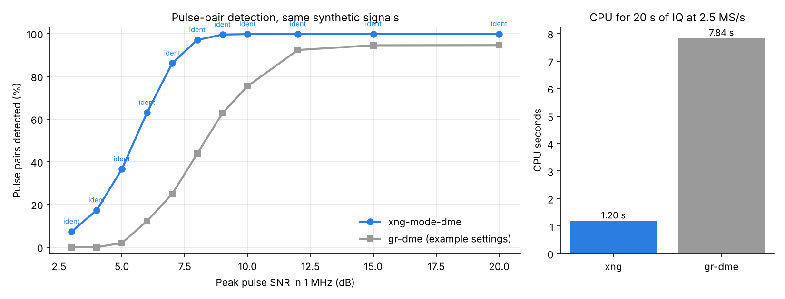

# DME receive (`--mode dme`)

Passive receiver for DME and TACAN ground transponders (ICAO Annex 10 Vol I
§3.5). xng never transmits, so it cannot measure its own distance; it reports
what a beacon sends: its pulse pairs, their rate, its Morse ident, and its
channel and paired VOR or ILS.

```bash
# 64X reply (1151 MHz), RTL-SDR at 2.4 MS/s
xng listen --sdr driver=rtlsdr -m dme -r 2400000 -c 1151.0M --channels 1151.0M
# Two adjacent channels from one capture
xng listen --sdr driver=rtlsdr -m dme -r 2400000 -c 1151.5M --channels 1151.0M,1152.0M
```

```text
09:09:48.350 [dme] 1151.000 MHz DME ident SFO (... ..-. ---) 64X
09:09:48.561 [dme] 1151.000 MHz DME status 64X reply 2946 pp/s (ident 296) snr 13.0 dB ident SFO
```

Find the reply frequency from the navaid's VHF frequency with the pairing
table (`xng_mode_dme::channels::DmeChannel::from_vhf`): a VOR on 113.00 MHz is
77X, whose reply is on 1164 MHz. DME, like ADS-B, is vertically polarized; a
1090 MHz antenna works.

## Messages

`kind = "ident"` when a Morse ident is decoded (every 30–40 s per beacon):

| field | |
|---|---|
| `ident`, `morse` | `SFO`, `... ..-. ---` |
| `dot_ms`, `ident_rate_hz` | measured keying speed and pair rate (1350 nominal) |
| `repeats` | times in a row the same ident was decoded |
| `channel`, `role`, `spacing_us` | `64X`, `reply` (or `interrogation`), 12 |
| `paired_vhf_hz`, `paired_kind` | VOR or ILS frequency the channel pairs with |

`kind = "status"` every 10 s of signal: `pps` (all pairs), `ident_pps`,
`random_pps` (squitter and replies), mean pair `snr_db`, `level_dbfs`,
`last_ident`, `reference_bursts_per_s` and `tacan` (15 Hz main reference
bursts seen), plus the channel fields.

Squitter and replies are the same pulse pair, so on the reply frequency only
their sum is observable. Tune the interrogation frequency of the channel
instead (for example 1088 MHz for 64X) and the same decoder reports aircraft
interrogations (`role: interrogation`), which is the beacon's reply load.

## How it works

- **Channel**: DDC to 1 MS/s, ±300 kHz. One sample per microsecond makes the
  12/30/36 µs spacings whole samples.
- **Pairs**: a Gaussian matched filter (3.5 µs wide) gives the pulse power
  `z`; for each spacing `D` the decision is on `z[n−D] + z[n]`, the energy of
  both pulses together, against a noise floor from block medians. Each half
  must also hold some power and at least 12 % of the other (a lone strong
  pulse is not a pair), and only the strongest candidate within the pair
  window survives (pulse skirts plus noise are not a second pair). Timing is
  refined with a parabolic fit.
- **Ident**: ident pairs repeat exactly every 740.7 µs, squitter is random.
  The period is learned from triples with equal gaps; a pair one to four
  periods after another pair is an ident hit. Hits per 10 ms bin, above the
  random-coincidence background, give the keying; a majority vote and a
  glitch merge clean it, and run lengths are read as Morse with an adaptive
  dot length. Because periodicity separates ident pairs from noise, the ident
  detector also gets pairs below the report threshold, which is why idents
  decode where most single pairs are lost.
- **Channel plan**: all 252 X/Y channels with their reply and interrogation
  frequencies, spacings and the VOR/ILS pairing (`channels.rs`).

## Benchmark against gr-dme

[gr-dme](https://github.com/daniestevez/gr-dme) is the open DME receiver to
beat (GNU Radio, GPL-3.0; run as an installed black box with the settings of
its own example flowgraph; it detects 12 µs pairs and has no ident decoder).
Both decoders got the same synthetic signals: 2.5 MS/s, 2700 pp/s random
pairs plus an "SFO" ident, three 5 s signals per SNR (48,570 pairs per SNR).
SNR is the peak pulse power over the noise in 1 MHz. Method and scripts:
[`bench/dme`](../../bench/dme/README.md); raw numbers:
[`bench/dme/results.json`](../../bench/dme/results.json).



| SNR (dB) | xng pairs | xng false/s | gr-dme pairs | gr-dme false/s | xng ident |
|---:|---:|---:|---:|---:|:---:|
| 3 | 7.3 % | 2.1 | 0.0 % | 0.0 | 3/3 |
| 4 | 17.3 % | 4.1 | 0.0 % | 0.0 | 3/3 |
| 5 | 36.5 % | 5.2 | 1.9 % | 5.7 | 3/3 |
| 6 | 62.9 % | 6.1 | 12.2 % | 14.5 | 3/3 |
| 7 | 86.1 % | 3.9 | 24.8 % | 14.8 | 3/3 |
| 8 | 97.0 % | 3.0 | 43.8 % | 15.7 | 3/3 |
| 9 | 99.5 % | 2.6 | 62.7 % | 16.7 | 3/3 |
| 10 | 99.7 % | 2.5 | 75.4 % | 16.7 | 3/3 |
| 12 | 99.7 % | 2.2 | 92.3 % | 15.0 | 3/3 |
| 15 | 99.8 % | 1.9 | 94.5 % | 12.5 | 3/3 |
| 20 | 99.8 % | 1.4 | 94.6 % | 10.3 | 3/3 |

"False" counts every detection more than 1.5 µs from a transmitted pair
(after removing each decoder's constant timing offset), so a badly timed real
pair counts too.

- **Sensitivity**: xng reaches 50 % of pairs about 3 dB below gr-dme and
  97 % at 8 dB, where gr-dme finds 44 %. At high SNR xng finds 99.8 % to
  gr-dme's 94.6 %.
- **No gr-dme setting closes the gap.** At 6 dB, lowering gr-dme's threshold
  from 10 to 4 raises it from 12 % to 60 % of pairs but to 96 false pairs per
  second; xng finds 63 % with 8.
- **Ident**: xng decoded the ident in every run down to 3 dB, where it
  detects 7 % of single pairs. gr-dme has no ident decoder.
- **Robustness** (8 dB): with a 20 kHz carrier offset xng finds 97 % (gr-dme
  37 %), at 60 kHz 90 % (25 %), and with cos² pulses instead of the Gaussian
  both matched filters assume 97 % (44 %).
- **CPU**: 20 s of 2.5 MS/s IQ took 1.20 s of CPU in xng (one thread,
  including the DDC) and 7.84 s in gr-dme's flowgraph, 6.5 times less. That
  is 17 times real time on one core of the benchmark machine.

Not yet measured: a real capture. Daniel Estévez's public LimeSDR DME
recording (Zenodo) could not be downloaded from the build environment; the
first off-air capture should go into `xng-corpus` under `iq/dme/`.
